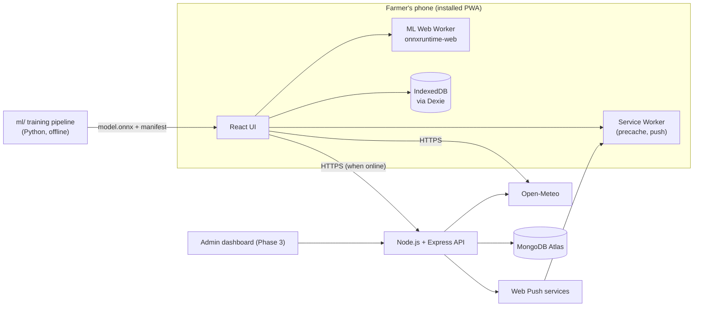

# Agrixore — Architecture (ARCHITECTURE.md)

> **Status:** Draft v1.0 · **Last updated:** 2026-10-08
> Companion to `PRODUCT.md` (WHAT) and `CLAUDE.md` (rules for AI tools).
> Tags: ✅ decided · 🟡 assumption (confirm) · ❓ open (ask the owner, do not invent).
> **The repository does not exist yet.** Everything below is the target design. When a file, script or folder is missing, create it according to this document; do not improvise a different layout.

---

## 1. Goals and constraints

| Constraint | Consequence |
|---|---|
| Offline-first for Phase 1 features | Model, runtime, content and data caches live on the device; the server is optional |
| Low-end Android phones, patchy data | Small bundles, quantized model, lazy loading, explicit caching |
| Solo developer building with AI tools | Simple architecture, strict conventions, strong typing, small modules |
| Urdu (RTL) + English | i18n and logical CSS from day one |
| Privacy | Photos stay on device by default; no PII stored on the server |
| FYP evaluation | Measurable ML results, clear documentation, defensible design decisions |

---

## 2. System overview



**Analogy:** the PWA is a farmer's pocket notebook that already contains the doctor (the model), the reference book (content), and yesterday's weather and prices. The Node API is a small office that only does what a phone cannot: send alerts, collect fresh market prices, and keep shared data.

**Key decisions (summary; full list in section 15):**
1. **Modular monolith** backend, not microservices. ✅
2. **Vite + React + TypeScript** PWA, not Next.js. ✅ (Offline-first client app needs no server rendering.)
3. **On-device inference** with ONNX Runtime Web in a Web Worker. ✅
4. **Data caching in IndexedDB (Dexie)**, static assets in the service worker cache. ✅
5. **No farmer accounts** in Phase 1–2; anonymous device ID. ✅
6. **Python is for training only**, never in production. ✅

---

## 3. Technology stack

Use the **latest stable versions at scaffold time**, then pin exact versions in the lockfile and record them in `docs/VERSIONS.md`. Do not upgrade major versions without an issue.

| Layer | Choice | Notes |
|---|---|---|
| Language | TypeScript (strict) everywhere except `ml/` | |
| Package manager | pnpm workspaces | Monorepo |
| Frontend | React + Vite | `apps/web` |
| Routing | React Router | Client-side routing |
| Styling | Tailwind CSS | Use **logical** utilities (`ms-*`, `me-*`, `ps-*`, `pe-*`, `start-*`, `end-*`, `text-start`) |
| Server state | TanStack Query | Network requests, retries, caching in memory |
| UI state | Zustand | Small global state (settings, UI) |
| Local database | Dexie (IndexedDB) | Scans, fields, caches, settings |
| PWA | `vite-plugin-pwa` (Workbox, `injectManifest`) | Custom service worker for push and sync |
| i18n | i18next + react-i18next | `en`, `ur` |
| ML runtime (browser) | `onnxruntime-web` (WASM, single thread) | In a Web Worker |
| Charts (P2) | A small chart library, lazy loaded ❓ | Or hand-rolled SVG for 2–3 charts |
| Backend | Node.js + Express | `apps/api` |
| Validation | zod | Shared schemas |
| Database | MongoDB Atlas + Mongoose | Free tier for development |
| Jobs | node-cron | Price ingestion, alert evaluation |
| Push | `web-push` (VAPID) | Phase 3 |
| Logging | pino | |
| Security middleware | helmet, cors (allowlist), express-rate-limit | |
| Unit/component tests | Vitest + Testing Library | |
| API tests | Vitest + supertest | |
| E2E | Playwright (including offline mode) | |
| Lint/format | ESLint + Prettier, `tsc --noEmit` | |
| ML training | Python, PyTorch (or TensorFlow/Keras), ONNX export | Colab/Kaggle GPU ❓ |
| CI | GitHub Actions | |
| Hosting | ❓ Static host for the PWA and a Node host for the API (to be chosen; check free-tier terms at deploy time) | |

---

## 4. Repository layout (monorepo)

```
agrixore/
├─ apps/
│  ├─ web/                      # Farmer PWA (Vite + React)
│  │  ├─ public/
│  │  │  ├─ icons/              # PWA icons (incl. maskable)
│  │  │  ├─ fonts/              # Self-hosted Latin + Urdu fonts (woff2, subset)
│  │  │  ├─ models/v1/          # model.onnx + manifest.json (see 7.4)
│  │  │  └─ ort/                # onnxruntime-web .wasm files (copied at build)
│  │  └─ src/
│  │     ├─ app/                # App shell, routes, providers, layout
│  │     ├─ features/
│  │     │  ├─ scan/            # capture, crop picker, result, history
│  │     │  ├─ weather/
│  │     │  ├─ mandi/
│  │     │  ├─ fields/          # P2
│  │     │  ├─ calendar/        # P2
│  │     │  ├─ calculators/     # P2
│  │     │  ├─ settings/
│  │     │  └─ onboarding/
│  │     ├─ components/         # Shared presentational components
│  │     ├─ db/                 # Dexie schema, migrations, repositories
│  │     ├─ ml/                 # worker, preprocessing, postprocessing, client
│  │     ├─ i18n/               # init + locales (en.json, ur.json)
│  │     ├─ lib/                # utilities (date, units, share, api client)
│  │     ├─ sw/                 # service worker source
│  │     └─ styles/             # tokens, global css
│  ├─ api/                      # Node API (Express)
│  │  └─ src/
│  │     ├─ config/             # env validation (zod)
│  │     ├─ middleware/
│  │     ├─ modules/<name>/     # routes, controller, service, repo, schema, tests
│  │     ├─ jobs/               # cron jobs
│  │     ├─ lib/                # logger, errors, http helpers
│  │     └─ server.ts, app.ts
│  └─ admin/                    # Phase 3 admin dashboard (Vite + React)
├─ packages/
│  └─ shared/                   # Types, zod schemas, constants (crops, units, thresholds)
├─ content/                     # Knowledge base (JSON, en+ur), calendars, review status
│  ├─ diseases/
│  └─ calendars/
├─ ml/                          # Training, evaluation, export (Python); data is git-ignored
│  ├─ configs/  notebooks/  src/  reports/  DATASETS.md  MODEL_CARD.md
├─ docs/                        # ADRs, VERSIONS.md, test checklists
├─ .github/                     # workflows, issue/PR templates
├─ PRODUCT.md  ARCHITECTURE.md  CLAUDE.md  README.md
├─ package.json  pnpm-workspace.yaml  tsconfig.base.json
```

Rules: features own their code; shared UI goes in `components/`; anything used by both web and api goes in `packages/shared`. No cross-feature imports except through a feature's public `index.ts`.

---

## 5. Frontend architecture (`apps/web`)

### 5.1 App shell and routing
- Single-page app with a bottom navigation (Home, Scan, Weather, Mandi) and a top bar (history, settings, language toggle).
- Routes are lazy loaded per feature (`React.lazy`) so the initial bundle stays small. The ML runtime and model load only when the Scan feature is opened (prefetch in idle time after install).
- Global error boundary with a friendly offline-safe fallback screen.

### 5.2 State and data flow
| Kind | Tool | Example |
|---|---|---|
| Persistent user data | Dexie | scans, fields, price targets, settings |
| Cached remote data with age | Dexie (`weatherCache`, `priceCache`) | forecast + `fetchedAt` |
| Server requests | TanStack Query, writing results through to Dexie | |
| Ephemeral UI state | Zustand / component state | selected crop chip, modal |

**Pattern for any remote data feature (weather, mandi, content):**
1. Read from Dexie first and render immediately (with "last updated").
2. If online, fetch in the background; on success write to Dexie and update the UI.
3. On failure keep showing cached data and show an unobtrusive "offline / may be out of date" note.
4. Never block the UI on the network.

### 5.3 PWA and service worker
- `vite-plugin-pwa` with **`injectManifest`** so the custom worker can also handle `push` and `notificationclick` (Phase 3) and background sync.
- **Precache:** app shell JS/CSS, HTML, icons, fonts, onnxruntime-web WASM files, `model.onnx`, `manifest.json`, bundled `content/` JSON.
- **Runtime caching:** only for static, non-sensitive assets. **API data is NOT cached by the service worker**; it is cached in Dexie where age and freshness are explicit.
- **Update strategy:** prompt-for-update (`registerType: 'prompt'`): show an "Update available" banner; apply on tap; never reload mid-scan.
- **Storage:** call `navigator.storage.persist()` after the first scan or install; surface storage usage in Settings.
- **Manifest:** name, short_name, `display: standalone`, theme/background colors, icons 192/512 plus maskable, `lang`, `dir`.

### 5.4 Internationalization and RTL
- i18next resources in `src/i18n/locales/{en,ur}.json`, namespaced per feature. Keys are semantic (`scan.result.confidence`), never the English sentence.
- On language change: update `document.documentElement.lang` and `dir` (`rtl` for `ur`), persist to settings.
- **CSS rule:** use Tailwind logical utilities only; never `ml-`/`mr-`/`left-`/`right-` for layout. Mirror directional icons in RTL (use an `rtl:` variant or a mirrored icon component).
- **Fonts:** self-hosted subset woff2 files; Urdu font ❓ (Naskh vs Nastaliq), exposed as CSS variable `--font-urdu`. Use a generous line height for Urdu.
- Dates/numbers: use `Intl` with the active locale but default to Western digits 🟡.
- Domain content (diseases, calendar, alerts) is bilingual structured JSON, not i18n keys; see section 9.

### 5.5 Camera and image handling
- Primary capture: `<input type="file" accept="image/*" capture="environment">` (most compatible). Optional later: `getUserMedia` live preview.
- Decode with `createImageBitmap(blob, { imageOrientation: 'from-image' })` to respect EXIF rotation; provide a fallback path if unsupported.
- Downscale large photos (longest side ≈ 1024 px) before processing and before storing. Store a small thumbnail (≈ 160–256 px) plus an optional compressed full image.
- **Never persist or share EXIF/GPS.** Re-encode through canvas before saving/sharing.

### 5.6 Sharing
`navigator.canShare({ files })` + `navigator.share` when available; otherwise a `https://wa.me/?text=` link plus a download of the generated image. The share image is rendered on a canvas (no external requests).

### 5.7 Accessibility and display modes
- `data-theme="light|sunlight"`, `data-text-size="normal|large|xl"`, `data-mode="standard|simple"` on `<html>`, driven by CSS variables.
- Touch targets ≥ 48 px, visible focus states, labels on all icons, `aria-live` for scan status, respect `prefers-reduced-motion`.

### 5.8 Performance budget 🟡 (verify and tune)
| Item | Target |
|---|---|
| Initial JS (app shell, gzip) | ≤ ~200 KB, excluding ML runtime and model |
| Model file (quantized) | ≤ ~10 MB |
| Inference after model load | ≤ ~3 s on a mid-range Android phone |
| Lighthouse PWA / Performance | PWA checks pass; Performance score monitored in CI |
| Main thread | Never blocked by inference (Web Worker) |

---

## 6. Local database (Dexie / IndexedDB)

Use versioned schemas with explicit migrations. Access only through repository functions in `src/db/`, never directly from components.

| Table | Key fields | Purpose |
|---|---|---|
| `settings` | `key`, `value` | language, crops, units, textSize, theme, mode, location, onboardingDone, deviceId |
| `scans` | `id`, `createdAt`, `crop`, `predictions[]`, `topClass`, `confidence`, `state`, `modelVersion`, `contentVersion`, `thumbnail` (Blob), `image` (Blob?), `fieldId?` | History |
| `weatherCache` | `locationKey`, `data`, `fetchedAt` | Offline weather |
| `priceCache` | `queryKey`, `rows[]`, `fetchedAt`, `marketDate` | Offline prices |
| `priceTargets` | `id`, `commodity`, `district`, `target`, `direction`, `active` | Local alerts (P1) |
| `fields` (P2) | `id`, `name`, `crop`, `sowingDate`, `area{value,unit}`, `district`, `lat?`, `lon?`, `irrigationSource?` | My Fields |
| `reminders` (P2) | `id`, `type`, `dueAt`, `scanId?`, `fieldId?`, `done` | Follow-ups, calendar tasks |
| `outbox` (P3) | `id`, `type`, `payload`, `createdAt`, `attempts` | Background sync queue |

`deviceId` is a random UUID generated on first run; it is not linked to a person.

---

## 7. On-device machine learning

### 7.1 Inference pipeline (browser)
```
photo (Blob)
  → createImageBitmap (EXIF-aware)
  → resize shorter side to `input.resizeShorterSide` (256), center-crop to the model input (224×224), exactly like training;
    resampling is Pillow-compatible (apps/web/src/ml/preprocess.ts), NOT the browser's canvas scaler
  → Float32 tensor, CHW, normalized with mean/std from manifest
  → ONNX Runtime Web (WASM, 1 thread) in a Web Worker
  → logits → temperature scaling (from manifest) → softmax
  → mask to the chosen crop's classes (+ not_a_leaf) and renormalize
  → top-k, decision state via thresholds (shared constants)
  → result to UI
```
- **One multi-crop model**, with the crop picker implemented as a **class mask** on the outputs. If the crop is "Not sure", use all classes and cap displayed trust.
- The worker exposes a typed message protocol: `init(modelUrl, manifest)`, `infer(imageBitmap, crop)` → `{ predictions, latencyMs, modelVersion }`, with errors returned as typed objects. Transfer the bitmap instead of copying.
- Load the model lazily, keep the session alive, and release resources when idle ❓.
- ONNX Runtime Web must be configured with `env.wasm.numThreads = 1` (multi-threading needs cross-origin isolation headers) and `env.wasm.wasmPaths` pointing at the self-hosted copy in `/ort/`.

### 7.2 Model manifest (`public/models/<version>/manifest.json`)
```json
{
  "version": "1.0.0",
  "createdAt": "ISO-8601",
  "experimental": true,
  "architecture": "mobilenetv3-small",
  "input": { "width": 224, "height": 224, "layout": "CHW", "mean": [0.485,0.456,0.406], "std": [0.229,0.224,0.225], "resizeShorterSide": 256 },
  "temperature": 1.0,
  "classes": [
    { "index": 0, "id": "maize_common_rust", "crop": "maize", "kind": "disease" },
    { "index": 1, "id": "not_a_leaf", "crop": null, "kind": "negative" }
  ],
  "sha256": "…",
  "metrics": { "accuracy": null, "fieldTestAccuracy": null },
  "datasets": ["see ml/DATASETS.md"]
}
```
The web app reads class ids **only from the manifest**; the class list must never be hard-coded in the UI. Values above are placeholders until training is done.

### 7.3 Training and export pipeline (`ml/`, Python)
1. **Dataset audit:** list sources, licenses, class counts, image quality; record in `ml/DATASETS.md`. Datasets are git-ignored.
2. **Splits:** stratified train/val/test **before** any augmentation. Public leaf datasets contain near-duplicate augmented images, so split by source/image group to avoid leakage. Keep a **separate field-photo test set** that never enters training.
3. **Negative class:** `not_a_leaf` built from varied non-leaf images (objects, soil, hands, sky, other plants/fruits).
4. **Model:** transfer learning from a pretrained lightweight backbone (MobileNetV3-Large or EfficientNet-Lite0; compare both). Heavier models (e.g. EfficientNetV2) are too big for the offline target but may serve the Phase 3 cloud model.
5. **Training:** field-realistic augmentation (lighting, blur, rotation, background variation), class-imbalance handling, fixed seeds, config in YAML, logged runs.
6. **Calibration:** temperature scaling on the validation set so confidence is meaningful; store `temperature` in the manifest.
7. **Export:** ONNX (use an opset supported by the chosen onnxruntime-web version), then **quantize (int8)** and verify the accuracy drop is acceptable.
8. **Parity test:** the same sample images must give matching outputs in PyTorch, ONNX (Python) and the browser (tolerance documented).
9. **Evaluation report:** per-class precision/recall/F1, confusion matrix, calibration curve, field-set accuracy, model size, latency on a real low-end phone → `ml/reports/` and `MODEL_CARD.md`.
10. **Publish:** copy `model.onnx` + `manifest.json` to `apps/web/public/models/<version>/` (Git LFS or release asset if large ❓).

### 7.4 Cloud second opinion (Phase 3)
A larger model served by the Node API using `onnxruntime-node`, returning the same response shape. Only called after an explicit user tap with consent. Not required for P1/P2.

---

## 8. Backend architecture (`apps/api`)

### 8.1 Style
Modular monolith. Each module under `src/modules/<name>/` has: `routes.ts` → `controller.ts` → `service.ts` → `repo.ts` (+ `schema.ts` zod, `*.test.ts`). Controllers only parse/validate and call services; services hold business logic; repos are the only code that touches Mongoose.

| Module | Phase | Responsibility |
|---|---|---|
| `health` | P1 | Liveness/readiness |
| `mandi` | P1 (seeded) → P3 (pipeline) | Commodities, markets, prices |
| `content` | P3 | Serve knowledge-base versions (ETag) |
| `devices` | P3 | Anonymous device prefs (district, crops, alert opt-ins) |
| `push` | P3 | Subscriptions, sending |
| `alerts` | P3 | Weather and price-target evaluation |
| `model` | P3 | Latest model version/manifest for OTA |
| `outbreak` | P3 | Opt-in reports and aggregated map |
| `feedback` | P3 | Opt-in feedback uploads and review queue |
| `admin` | P3 | Admin auth and management endpoints |
| `inference` | P3 (optional) | Cloud second opinion |

### 8.2 Conventions
- **Base path:** `/api/v1`. JSON only (multipart for image uploads).
- **Success:** `{ "data": …, "meta": { … } }`. **Error:** `{ "error": { "code": "VALIDATION_ERROR", "message": "…", "details": … } }` with correct HTTP status codes.
- **Validation:** zod schemas from `packages/shared` on every request body/query/params.
- **Config:** environment variables validated at startup with zod; the app refuses to start on invalid config. Provide `.env.example`; never commit `.env`.
- **Security:** helmet, CORS allowlist, rate limiting on all routes (stricter on uploads), request size limits, no stack traces to clients, dependency audit in CI. Admin routes use JWT in an httpOnly, secure, SameSite cookie 🟡 with password hashing (argon2 or bcrypt).
- **Identity for farmers:** anonymous `deviceId` header; no PII; treat as untrusted (rate limit by IP and device).
- **Logging:** pino structured logs with request ids; no personal data or photo contents.

### 8.3 Data models (MongoDB; defined as TypeScript types + zod in `packages/shared`)
| Collection | Key fields |
|---|---|
| `commodities` | `id`, `name{en,ur}`, `unit`, `active` |
| `markets` | `id`, `name{en,ur}`, `province`, `district` |
| `mandiPrices` | `commodityId`, `marketId`, `marketDate`, `min`, `modal`, `max`, `unit`, `currency`, `source`, `ingestedAt` (unique on commodity+market+date) |
| `pushSubscriptions` | `deviceId`, `endpoint`, `keys`, `locale`, `district`, `crops[]`, `alertPrefs`, `createdAt` |
| `priceTargets` | `deviceId`, `commodityId`, `district`, `target`, `direction`, `active`, `lastNotifiedAt` |
| `diseaseContent` | content schema in section 9, plus `version`, `reviewStatus` |
| `modelVersions` | `version`, `manifest`, `url`, `sha256`, `publishedAt`, `active` |
| `outbreakReports` | `crop`, `diseaseId`, `district`, `weekStart`, `count` (aggregated; no deviceId stored) |
| `feedbackItems` | `imageKey`, `crop`, `predictedId`, `correctedId`, `consentAt`, `status` (pending/approved/rejected), `reviewedBy` |
| `adminUsers` | `email`, `passwordHash`, `role` |

### 8.4 API surface (v1)

| Method | Path | Auth | Phase | Purpose |
|---|---|---|---|---|
| GET | `/health` | none | P1 | Health check |
| GET | `/mandi/commodities` | none | P1 | List commodities |
| GET | `/mandi/markets?province=&district=` | none | P1 | List markets |
| GET | `/mandi/prices?commodity=&province=&district=&market=&from=&to=` | none | P1 | Price rows and `marketDate` |
| PUT | `/devices/:deviceId/preferences` | device | P3 | Save district, crops, alert opt-ins |
| POST / DELETE | `/push/subscriptions` | device | P3 | Register / remove web push subscription |
| GET / POST / DELETE | `/alerts/price-targets` | device | P3 | Server-side price targets |
| GET | `/content/diseases?since=` | none | P3 | Knowledge-base updates (ETag) |
| GET | `/model/latest` | none | P3 | Latest model manifest and URL |
| POST | `/outbreak/reports` | device (opt-in) | P3 | Submit anonymized scan result |
| GET | `/outbreak/map?crop=&days=` | none | P3 | Aggregated counts (k-anonymity) |
| POST | `/feedback` | device (opt-in) | P3 | Upload a corrected scan (multipart) |
| POST | `/inference/second-opinion` | device (opt-in) | P3 | Cloud model prediction |
| POST | `/admin/auth/login` | none | P3 | Admin login |
| CRUD | `/admin/diseases`, `/admin/prices/import`, `/admin/alerts/broadcast`, `/admin/models`, `/admin/feedback` | admin | P3 | Management |

Paginate list endpoints; return `ETag`/`Cache-Control` where useful.

### 8.5 Scheduled jobs (`node-cron`)
| Job | Schedule | Action |
|---|---|---|
| `ingestMandiPrices` | daily ❓ | Fetch/import prices, validate, upsert, record source and time. **Never fabricate or fill gaps with guesses.** |
| `evaluateWeatherAlerts` | every few hours ❓ | Group subscribers by district; fetch Open-Meteo once per district; apply thresholds; send push; dedupe by `lastNotifiedAt` |
| `evaluatePriceTargets` | after each ingestion | Match new prices to targets; push; dedupe |
| `aggregateOutbreaks` | daily | Roll up reports; enforce minimum count per cell |
| `cleanup` | daily | Delete stale subscriptions (410/404 from push service), expired feedback |

Run jobs in the same process for simplicity 🟡; make them idempotent so a second instance cannot double-send.

### 8.6 Push flow (Phase 3)
1. PWA asks for notification permission after an explicit user action (never on first load).
2. `PushManager.subscribe({ applicationServerKey: VAPID_PUBLIC })` → send subscription to `/push/subscriptions`.
3. A job decides an alert is due → `web-push` sends an encrypted payload.
4. The service worker shows the notification; `notificationclick` opens the relevant screen.
5. On a 404/410 response from the push service, delete the subscription.
Note: on iOS/iPadOS web push only works for a PWA added to the Home Screen.

### 8.7 Privacy and safety design (outbreak and feedback)
- Opt-in only, off by default, revocable.
- Outbreak data keeps only crop, disease, **district** and week; **no deviceId, no exact location, no image**. The public map shows a cell only if its count ≥ a minimum `K` (config).
- Feedback images are re-encoded to strip EXIF/GPS, stored in object storage ❓, reviewed by a human before any use in training.
- Provide a way to delete a device's server-side data.

---

## 9. Content / knowledge-base schema

Source of truth in Phase 1–2: JSON files in `content/diseases/<id>.json`, reviewed through pull requests and bundled into the PWA (offline). In Phase 3 the same schema is stored in MongoDB and edited via the admin dashboard, with the repo files as the seed.

```ts
type Lang = 'en' | 'ur';
type L10n = Record<Lang, string>;
type L10nList = Record<Lang, string[]>;

interface DiseaseContent {
  id: string;                  // must match a class id in the model manifest, e.g. "maize_common_rust"
  crop: 'maize' | 'wheat' | 'cotton';
  kind: 'disease' | 'pest' | 'virus' | 'healthy';
  name: L10n;
  summary: L10n;
  symptoms: L10nList;
  spread: L10n;
  prevention: L10nList;
  treatment: {
    cultural: L10nList;
    organic: L10nList;
    chemical: Array<{
      activeIngredient: string;      // generic name, no brands
      note: L10n;                    // how/when, from reviewed sources only
      dosage?: L10n;                 // ONLY when reviewStatus === 'reviewed'
      preHarvestIntervalDays?: number;
    }>;
  };
  safety: L10nList;
  whenToCallExpert: L10n;
  reviewStatus: 'draft' | 'reviewed';
  reviewedBy?: string;
  reviewedAt?: string;           // ISO date
  sources: Array<{ title: string; url?: string }>;
  version: number;
}
```
**Rules:** `crop` ids use `maize` internally (UI label "Corn"/"مکئی"). Validate all content files with zod in CI. A content file whose `id` has no matching model class (or vice versa) fails CI. UI must hide `dosage` unless `reviewStatus === 'reviewed'`.

Crop calendar files (`content/calendars/<crop>.json`, Phase 2) list growth stages (relative to sowing day), tasks per stage, and sources with review status. ❓ Values must come from official guidance; never invent timings.

---

## 10. Shared package (`packages/shared`)

Exports: zod schemas and types for API payloads and content; constants — `CROPS`, `CONFIDENCE_THRESHOLDS`, `ALERT_THRESHOLDS`, unit conversion constants, `SUPPORTED_LANGS`. **No magic numbers elsewhere.** All thresholds are marked `// TODO: calibrate / review` until validated.

Unit constants (🟡 confirm regional standards): `1 maund = 40 kg`, `1 acre = 8 kanal`, `1 kanal = 20 marla`, `1 marla = 272.25 sq ft`, `1 acre = 43,560 sq ft`.

---

## 11. Environments, deployment and CI/CD

| Environment | Purpose |
|---|---|
| local | `pnpm dev` for web + api; local or Atlas dev database |
| preview | Per-PR preview deploy of the web app ❓ |
| production | Static PWA host + Node host + Atlas |

**Environment variables (API):** `NODE_ENV`, `PORT`, `MONGODB_URI`, `CORS_ORIGINS`, `VAPID_PUBLIC_KEY`, `VAPID_PRIVATE_KEY`, `VAPID_SUBJECT`, `JWT_SECRET`, `ADMIN_BOOTSTRAP_EMAIL`, `OUTBREAK_MIN_COUNT`, storage keys (❓). **Web (build-time, public only):** `VITE_API_BASE_URL`, `VITE_VAPID_PUBLIC_KEY`. Only variables prefixed `VITE_` reach the browser; never put secrets there.

**GitHub Actions (on every PR):** install (cached pnpm) → lint → typecheck → unit/component tests → API tests → build web + api → validate `content/` against the schema and model manifest → (main only) deploy. Optional: Playwright offline E2E and Lighthouse CI. Dependabot enabled.

**Branching:** short-lived feature branches from `main`; `main` protected; PR required; Conventional Commits.
**Large files:** datasets never in Git; model file via Git LFS or release asset ❓.

---

## 12. Testing strategy

| Level | Tooling | What to cover |
|---|---|---|
| Unit | Vitest | Pure logic: thresholds → result state, irrigation rules, alert rules, unit conversions, calendar stage math, price target matching |
| Component | Testing Library | Result screen states, language/RTL switching, crop chips |
| API | Vitest + supertest | Validation, error format, pagination, auth, jobs idempotency |
| Content | CI script | Schema validity, id ↔ manifest match, reviewed/draft rules |
| E2E | Playwright | Onboarding, scan with a fixture image, **offline mode** (`context.setOffline(true)`), install/update flow |
| ML | Python tests | Preprocessing parity, ONNX vs PyTorch parity |
| Manual | `docs/TEST_CHECKLIST.md` | Real low-end Android phone: install, airplane-mode scan, Urdu RTL, sunlight mode, push (P3) |

Rule: never claim a test passed unless it was actually run.

---

## 13. Observability

`GET /health`, structured pino logs, optional error tracking ❓ (strip PII), optional privacy-friendly aggregate analytics ❓ (opt-in). Log model version and latency (not images) in client diagnostics shown in Settings → About.

---

## 14. Known pitfalls (read before implementing)

1. **onnxruntime-web in Vite:** serve the `.wasm` files from your own origin (copy at build), set `env.wasm.wasmPaths`, run in a Web Worker, single thread. Missing or wrongly pathed WASM is the most common failure.
2. **Service worker caching of big files:** the model (~10 MB) must be precached and versioned by path (`/models/v1/…`), otherwise updates break or re-download.
3. **iOS:** web push works only for Home-Screen PWAs; Safari may evict storage for sites not used for a while, so request persistent storage and keep a clear offline-data message.
4. **Camera input:** `capture` behavior varies; always keep the gallery option.
5. **EXIF orientation:** photos can appear rotated; decode with orientation handling.
6. **RTL bugs:** most come from physical CSS properties (`left/right`) and unmirrored icons.
7. **Dexie schema changes:** always bump the version and write a migration; never edit an old version in place.
8. **Open-Meteo:** pass `timezone` (use `Asia/Karachi`) and request only needed fields; cache by rounded coordinates to avoid needless calls.
9. **Confidence is not accuracy:** uncalibrated softmax is overconfident; keep calibration in the pipeline.
10. **Docs drift:** when a decision changes, update these docs in the same PR.

Open-Meteo query sketch: `current=temperature_2m,relative_humidity_2m,wind_speed_10m,weather_code` and `daily=temperature_2m_max,temperature_2m_min,precipitation_sum,precipitation_probability_max,et0_fao_evapotranspiration`, `forecast_days=7`. 🟡 Verify parameter names against current Open-Meteo documentation when implementing.

---

## 15. Architecture decision records (summary)

| ADR | Decision | Reason | Revisit when |
|---|---|---|---|
| 001 | Modular monolith backend | Solo dev; simple to build, test and deploy | Real scaling needs |
| 002 | Vite + React PWA, not Next.js | Offline-first client app; no SSR needed; simpler service-worker story | — |
| 003 | On-device inference (ONNX Runtime Web) | Works offline; private; no server cost | Model too slow/large on target devices |
| 004 | Dexie for data caches; SW only for static assets | Explicit freshness and "last updated" control | — |
| 005 | No farmer accounts in P1–P2 | Lower friction; less PII | Features need cross-device sync |
| 006 | MongoDB Atlas + Mongoose | Owner's existing MERN skills; flexible documents | Need relational reporting |
| 007 | Open-Meteo for weather | Free, no key, includes evapotranspiration | Terms or coverage issue |
| 008 | One multi-crop model with class masking | Smaller footprint than three models; crop picker still improves accuracy | Per-crop accuracy gaps |
| 009 | Content in Git (P1–P2), DB + admin (P3) | Review through PRs first; admin later | — |
| 010 | Generic active ingredients, no brands; dosage only if reviewed | Safety and neutrality | — |

---

## 16. Phase-to-architecture map

| Phase | Frontend | Backend | ML |
|---|---|---|---|
| P1 | PWA shell, i18n/RTL, scan, weather, mandi, history, share, settings | `health`, `mandi` (seeded data, same API shape) | Train baseline, export, in-browser inference, calibration |
| P2 | Fields, calendar, calculators, photo guidance, follow-ups, trends, audio/modes | Optional small additions only | Add severity/heatmap if validated; pests/viruses |
| P3 | Push, outbox/sync, OTA updates, opt-in sharing | Push, alerts, jobs, admin, outbreak, feedback, content, model, optional inference | Retraining loop; cloud model |
| P4 | Assistant UI, teleconsulting UI, more locales | Assistant and real-time services | — |

---

## 17. Open decisions (ask the owner; do not decide silently)

| # | Question |
|---|---|
| 1 | Hosting for the PWA and for the API; object storage for feedback images |
| 2 | Mandi price source (spike result) |
| 3 | Final disease class list per crop (after dataset audit) |
| 4 | Urdu font (Naskh vs Nastaliq) and color palette |
| 5 | Verified list of Pakistani districts with coordinates |
| 6 | Source and reviewer for crop calendars, fertilizer rates, treatment content |
| 7 | Which AI coding tool will be used (Claude Code recommended) |
| 8 | Model hosting for large files (Git LFS vs release assets) |
